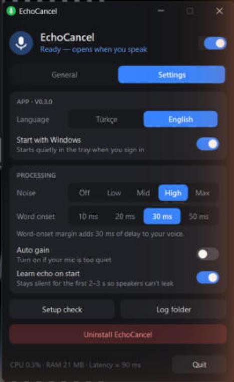

# EchoCancel — keep your speakers on, send only your voice to Discord

**Stop game sounds, YouTube, music and your friends' voices from leaking out of your speakers into your microphone.**
EchoCancel is a tiny Windows tray app that does real-time acoustic echo cancellation (the same WebRTC AEC3 engine used by Chrome and Google Meet) using what your speakers are *actually playing* as a reference, then sends only your voice to Discord through a virtual microphone.

No headset required. No GPU. Runs 100% locally. ~0.5 % CPU, ~25 MB RAM.

[**⬇ Download the installer (Windows 10/11, 64-bit)**](../../releases/latest) · [Türkçe açıklama aşağıda](#türkçe)

<p align="center">
  
  &nbsp;&nbsp;
  
</p>
<p align="center"><sub>Left: speakers are playing (purple bar) but nothing reaches Discord (green bar stays empty) until you speak.</sub></p>

---

## The problem

You use a webcam mic (e.g. Logitech Brio) or a desk mic with **speakers**, not a headset. Everything that comes out of your speakers — the game, a video, your friends talking in Discord — goes back into your mic, and your friends hear themselves and your game. Discord's own noise suppression (Krisp) and echo cancellation don't fully fix this, especially for loud game audio, music and videos.

## How EchoCancel fixes it

```
 Game / video / Discord audio ──► Your speakers  (keep playing normally)
                                    │
                                    └─ copy via WASAPI loopback ───────────┐ reference
 Microphone ── capture ──► [ align ] ──► WebRTC AEC3 echo canceller + noise suppression
                                                    │
                                          voice gate (mutes when you're silent,
                                          30 ms look-ahead so first words aren't cut)
                                                    │
                                     "CABLE Input"  (EchoCancel writes here)
                                                    │
                     Discord input device = "CABLE Output" (VB-CABLE virtual mic)
```

* **Real echo cancellation, not just a noise gate** – it knows exactly what your speakers play and subtracts it, so you can talk *while* a video or game is playing and still be heard.
* **Voice gate after AEC** – when you stop talking, Discord receives true digital silence. A short look-ahead keeps the start of words.
* **Clock drift and delay compensation** – mic, speakers and the virtual cable run on different hardware clocks; EchoCancel keeps them aligned.
* **Fail-safe** – if anything stops (device unplugged, app closed, error), Discord gets *silence*, never your raw, echo-filled mic.
* **Recovers by itself** when you unplug/replug your mic or switch speakers/headphones.
* **Tray app** with a small dark window, live level meters, Turkish / English UI, start with Windows, one-click uninstall.

## Install (one click)

1. Download **`EchoCancel-Setup-x.y.z.exe`** from [Releases](../../releases/latest) and run it → **Yes → Install → Finish**.
   * The .NET runtime is included; nothing else to install.
   * If the free **VB-CABLE** virtual audio cable is missing, setup downloads it from the official site ([vb-audio.com](https://vb-audio.com/Cable/)) and installs it. If Windows asks to install a driver, click **Install**.
   * If VB-CABLE made itself the default Windows speaker/mic, setup puts your real devices back.
2. In **Discord → User Settings → Voice & Video**:
   * **Input Device:** `CABLE Output (VB-Audio Virtual Cable)`
   * **Output Device:** your speakers (same as in EchoCancel)
   * **Echo Cancellation:** off · **Input Sensitivity:** turn off automatic, slide almost all the way left
3. Click the microphone icon next to the clock to open EchoCancel. Done.

> **Windows SmartScreen** may say “Windows protected your PC” because the installer is not code-signed. Click **More info → Run anyway**. The full source code is in this repository.

### Which device goes where

| Where | Setting | Select |
|---|---|---|
| EchoCancel → Microphone | your real mic | e.g. *Logitech BRIO* (or Automatic) |
| EchoCancel → Speakers | what you hear | your speakers (or Automatic) |
| EchoCancel → To Discord | virtual cable | *CABLE Input* (Automatic) |
| Discord → Input Device | microphone | **CABLE Output** |
| Discord → Output Device | speakers | the same speakers as in EchoCancel |
| Windows default output | — | your speakers (**not** CABLE Input) |

It works the same way for Zoom, Teams, OBS, games etc. — just pick **CABLE Output** as their microphone.

## Settings

| Setting | What it does |
|---|---|
| **Protection** (Light / Normal / Strict) | How aggressively speaker sound is blocked. *Light*: your voice is cut less, a little speaker sound may leak. *Strict*: no leaks, but your voice may cut when you and the speakers talk at the same time. |
| **Voice gate** (Off / Low / Medium / High) | Mutes Discord while you're silent. *High* lets quiet speech through (typing may open it). |
| **Noise** | WebRTC noise suppression level. |
| **Word onset** | Look-ahead so the first syllable isn't cut. Adds that much delay. |
| **Learn echo on start** | Keeps the output muted for ~2–3 s at start while the echo canceller adapts, so nothing leaks. |
| **Setup check** | Shows what's missing (VB-CABLE, wrong default devices, Discord input) and fixes it with one click. |

## Testing it yourself

| Scenario | What to do | Expected |
|---|---|---|
| Only you talk | Count 1–20 with pauses | Natural voice, first words intact, silence between |
| Only speakers play | Play a talking video / game for a minute, stay silent | Your friends hear nothing (after the first ~2 s) |
| Both at once | Talk while a video plays | You are heard; the video is gone or very faint |
| Device change | Unplug/replug the mic, switch speakers ↔ headphones | Icon turns orange, Discord gets silence, recovers in 1–3 s |

Record **CABLE Output** in Audacity / Windows Sound Recorder, or ask a friend in a voice channel.

## Known limitations

* If your speakers are as loud in the mic as your own voice, the start of your words can be softened while both talk at once. Lower the speaker volume or move them away from the mic.
* Only the selected speaker device is used as the reference. Audio played on another device can't be removed.
* The voice gate is energy-based: loud keyboard clicks can open it briefly.
* While EchoCancel is closed, Discord receives silence. To talk without it, set Discord's input back to your mic.

## Performance (measured)

* Processing: ~95 µs per 10 ms audio frame on a 2.1 GHz Xeon VM (≈1 % of one core). Algorithmic latency ≈ 55 ms (+ buffers ≈ 70–100 ms total).
* On a Windows 11 PC (Logitech Brio 100, Realtek speakers): window opens in ~100 ms, ~0.5 % CPU, ~21–25 MB private RAM.
* Offline simulation with real speech and a synthetic room (45 ms delay, 150 ppm clock drift): 48 dB echo suppression after convergence, 0 s of speaker leakage through the gate, 100 % of near-end speech passed. Details: [`docs/simulation-results.txt`](docs/simulation-results.txt). A real room is harder than this simulation.

## Build from source

Requirements: .NET 10 SDK, and NSIS 3 for the installer.

```powershell
dotnet publish src\EchoCancel.App -c Release -r win-x64 --self-contained true -p:PublishReadyToRun=true -p:DebugType=none -o dist\pub
copy LICENSE dist\pub\LICENSE.txt & copy THIRD-PARTY-NOTICES.txt dist\pub\
makensis -INPUTCHARSET UTF8 -DPAYLOAD=dist\pub -DVERSION=0.3.0 -DOUTFILE=dist\EchoCancel-Setup-0.3.0.exe installer\EchoCancel.nsi
```

| Folder | Contents |
|---|---|
| `src/EchoCancel.Core` | Platform-independent DSP: WebRTC APM P/Invoke, `EchoPipeline`, `VoiceGate`, `DriftBuffer`, `DelayEstimator` |
| `src/EchoCancel.App` | Windows app: WASAPI engine with device cache and recovery, tray UI, setup checks, VB-CABLE installer |
| `src/EchoCancel.Sim` | Offline tests: `selftest`, `bench`, `file`, `sim` |
| `installer/` | NSIS one-click installer (English / Turkish) |

Settings and log: `%AppData%\EchoCancel\`.

## Credits & licenses

EchoCancel is MIT-licensed. It uses the **WebRTC Audio Processing Module** (BSD-3-Clause, via the [SoundFlow](https://github.com/LSXPrime/SoundFlow) native build, MIT), **[NAudio](https://github.com/naudio/NAudio)** (MIT) and the .NET runtime (MIT). **VB-CABLE** is donationware by [VB-Audio](https://vb-audio.com/Cable/); it is not bundled but downloaded from the vendor at install time. See [`THIRD-PARTY-NOTICES.txt`](THIRD-PARTY-NOTICES.txt).

---

## Türkçe

**EchoCancel, hoparlörün açıkken Discord'a yalnızca senin sesini gönderir.** Hoparlörden çıkan oyun, video, müzik ve arkadaşlarının sesi mikrofonuna girip karşı tarafa gitmez. Kulaklık gerekmez, ekran kartı gerekmez, her şey bilgisayarında çalışır.

**Nasıl çalışır:** Hoparlörün o an ne çaldığını (WASAPI loopback) referans alır ve Chrome/Google Meet'in de kullandığı WebRTC AEC3 yankı gidericiyle bunu mikrofon sesinden çıkarır. Sustuğunda Discord'a tam sessizlik gider. Sonuç, VB-CABLE sanal mikrofonu üzerinden Discord'a ulaşır.

**Kurulum:**
1. [Releases](../../releases/latest) sayfasından **`EchoCancel-Setup-x.y.z.exe`** dosyasını indir, çalıştır: **Evet → Kur → Son**. VB-CABLE yoksa kurulum onu kendisi indirip kurar. Windows sürücü onayı sorarsa **Yükle**'ye bas.
2. Discord → Kullanıcı Ayarları → Ses ve Görüntü: **Giriş Aygıtı = CABLE Output**, **Yankı Engelleme = kapalı**.
3. Saatin yanındaki mikrofon simgesine tıkla. Arayüz Türkçe ve İngilizce; dili Ayarlar sekmesinden değiştirebilirsin.

SmartScreen "Windows bilgisayarınızı korudu" derse: **Ek bilgi → Yine de çalıştır** (kurulum dosyası imzasız; kaynak kod bu depoda).

Ayrıntılı Türkçe teknik notlar: [`docs/teknik-notlar-tr.md`](docs/teknik-notlar-tr.md).

---

<sub>Keywords: discord echo cancellation speakers, stop speaker audio leaking into microphone, remove game sound from mic, webcam mic echo, acoustic echo cancellation windows, AEC virtual microphone, Logitech Brio echo, Discord hears my speakers, yankı engelleme, hoparlör sesi mikrofona giriyor.</sub>
