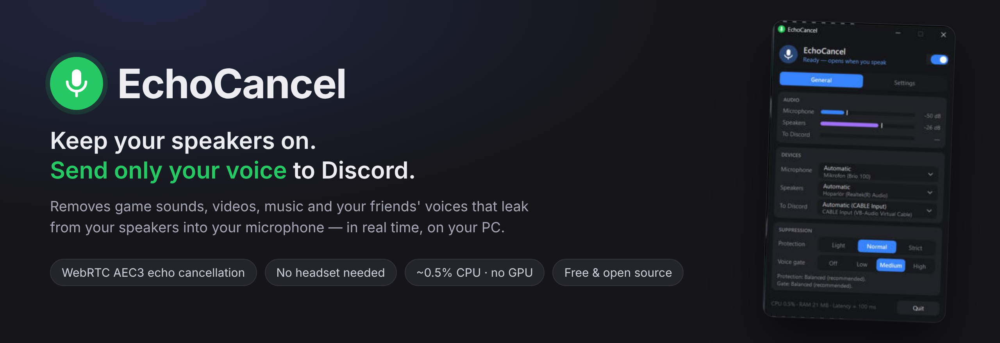
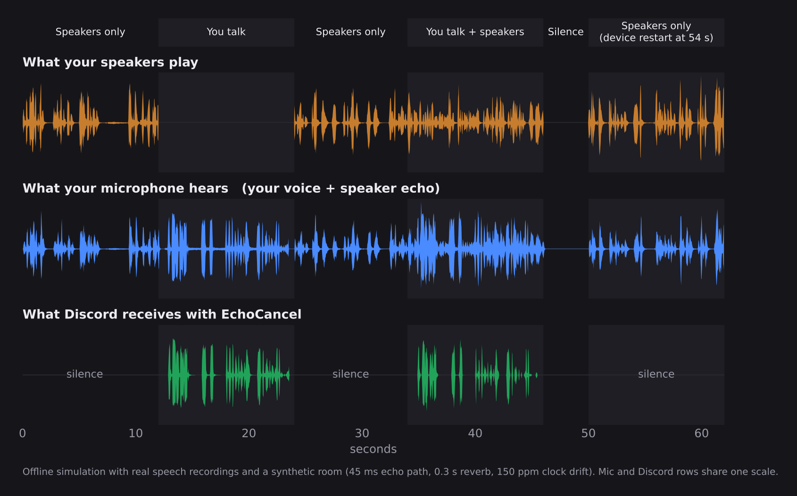
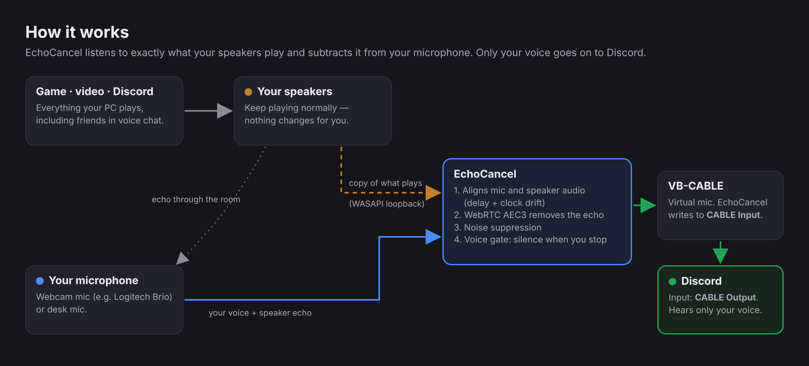
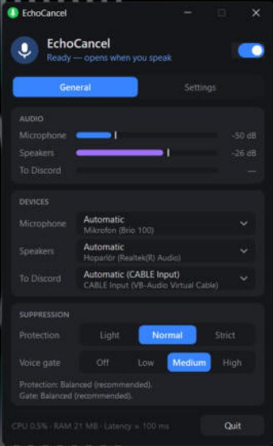

<p align="center">
  
</p>

<p align="center">
  <a href="../../releases/latest"></a>
  &nbsp;
  <a href="LICENSE"></a>
  &nbsp;
  <a href="#türkçe"></a>
</p>

# EchoCancel

**Use your speakers *and* your mic in Discord — without everyone hearing your game, your YouTube video, or themselves.**

If you play or chat with **speakers instead of a headset**, everything that comes out of them — game sounds, music, videos, your friends talking — goes straight back into your microphone. Your friends hear an echo of themselves and your game on top of your voice. Discord's own *Echo Cancellation* only knows about Discord's own sound, and *Krisp* is built for background noise, so game audio, music and videos from other apps still get through.

**EchoCancel fixes that.** It listens to *exactly* what your speakers are playing and subtracts it from your microphone in real time, using the same **WebRTC AEC3** echo canceller that powers Chrome and Google Meet. Then it mutes the output while you're silent, so Discord gets **only your voice** — and true silence the rest of the time.

* 🎧 **No headset needed** — keep using your speakers and webcam / desk mic
* 🗣️ **Talk over a video or game and still be heard** — it's real echo cancellation, not just a noise gate
* 🔇 **Silence when you're quiet** — a voice gate with look-ahead so your first word isn't cut
* 🛡️ **Fail-safe** — if anything stops, Discord gets silence, never your raw echo-filled mic
* ⚡ **Light** — ~0.5 % CPU, ~25 MB RAM, no GPU, 100 % local, nothing is uploaded anywhere
* 🖱️ **One-click install** — sets up the virtual microphone for you; English / Türkçe interface

## See the difference

<p align="center">
  
</p>

Top: what your speakers play. Middle: what your microphone picks up — your voice **plus** the speaker echo. Bottom: what Discord gets from EchoCancel — **only your voice**, and silence whenever only the speakers are playing (even right after a device restart at 54 s).
<sub>Real audio from the project's offline simulation: real speech recordings played through a synthetic room. A real room is harder; see [Performance](#performance-measured).</sub>

## How it works

<p align="center">
  
</p>

* **Real echo cancellation, not just a gate** – EchoCancel knows exactly what your speakers play, so it can remove it even *while* you talk.
* **Delay and clock-drift compensation** – the mic, speakers and virtual cable run on different hardware clocks; EchoCancel keeps them aligned.
* **Recovers by itself** when you unplug or replug your mic or switch between speakers and headphones.

## The app

<p align="center">
  
  &nbsp;&nbsp;&nbsp;
  
</p>
<p align="center"><sub><b>General:</b> the speakers are playing (purple bar), but nothing reaches Discord (green bar stays empty) until you speak.<br><b>Settings:</b> language, start with Windows, noise suppression, setup check and one-click uninstall.</sub></p>

It lives in the tray next to the clock. The icon colour shows the state: **grey** off · **orange** waiting / learning the echo · **blue** ready · **green** you're on air.

## Install (one click)

1. Download **`EchoCancel-Setup-x.y.z.exe`** from [Releases](../../releases/latest) and run it → **Yes → Install → Finish**.
   * The .NET runtime is included; nothing else to install.
   * If the free **VB-CABLE** virtual audio cable is missing, setup downloads it from the official site ([vb-audio.com](https://vb-audio.com/Cable/)) and installs it. If Windows asks to install a driver, click **Install**.
   * If VB-CABLE made itself the default Windows speaker/mic, setup puts your real devices back.
2. In **Discord → User Settings → Voice & Video**:
   * **Input Device:** `CABLE Output (VB-Audio Virtual Cable)`
   * **Output Device:** your speakers (same as in EchoCancel)
   * **Echo Cancellation:** off · **Input Sensitivity:** turn off automatic, slide almost all the way left
3. Click the microphone icon next to the clock to open EchoCancel. Done.

> **Windows SmartScreen** may say “Windows protected your PC” because the installer is not code-signed. Click **More info → Run anyway**. The full source code is in this repository.

### Which device goes where

| Where | Setting | Select |
|---|---|---|
| EchoCancel → Microphone | your real mic | e.g. *Logitech BRIO* (or Automatic) |
| EchoCancel → Speakers | what you hear | your speakers (or Automatic) |
| EchoCancel → To Discord | virtual cable | *CABLE Input* (Automatic) |
| Discord → Input Device | microphone | **CABLE Output** |
| Discord → Output Device | speakers | the same speakers as in EchoCancel |
| Windows default output | — | your speakers (**not** CABLE Input) |

It works the same way for Zoom, Teams, OBS, games etc. — just pick **CABLE Output** as their microphone.

## Settings

| Setting | What it does |
|---|---|
| **Protection** (Light / Normal / Strict) | How aggressively speaker sound is blocked. *Light*: your voice is cut less, a little speaker sound may leak. *Strict*: no leaks, but your voice may cut when you and the speakers talk at the same time. |
| **Voice gate** (Off / Low / Medium / High) | Mutes Discord while you're silent. *High* lets quiet speech through (typing may open it). |
| **Noise** | WebRTC noise suppression level. |
| **Word onset** | Look-ahead so the first syllable isn't cut. Adds that much delay. |
| **Learn echo on start** | Keeps the output muted for ~2–3 s at start while the echo canceller adapts, so nothing leaks. |
| **Setup check** | Shows what's missing (VB-CABLE, wrong default devices, Discord input) and fixes it with one click. |

## Testing it yourself

| Scenario | What to do | Expected |
|---|---|---|
| Only you talk | Count 1–20 with pauses | Natural voice, first words intact, silence between |
| Only speakers play | Play a talking video / game for a minute, stay silent | Your friends hear nothing (after the first ~2 s) |
| Both at once | Talk while a video plays | You are heard; the video is gone or very faint |
| Device change | Unplug/replug the mic, switch speakers ↔ headphones | Icon turns orange, Discord gets silence, recovers in 1–3 s |

Record **CABLE Output** in Audacity / Windows Sound Recorder, or ask a friend in a voice channel.

## Known limitations

* If your speakers are as loud in the mic as your own voice, the start of your words can be softened while both talk at once. Lower the speaker volume or move them away from the mic.
* Only the selected speaker device is used as the reference. Audio played on another device can't be removed.
* The voice gate is energy-based: loud keyboard clicks can open it briefly.
* While EchoCancel is closed, Discord receives silence. To talk without it, set Discord's input back to your mic.

## Performance (measured)

* Processing: ~95 µs per 10 ms audio frame on a 2.1 GHz Xeon VM (≈1 % of one core). Algorithmic latency ≈ 55 ms (+ buffers ≈ 70–100 ms total).
* On a Windows 11 PC (Logitech Brio 100, Realtek speakers): window opens in ~100 ms, ~0.5 % CPU, ~21–25 MB private RAM.
* Offline simulation with real speech and a synthetic room (45 ms delay, 150 ppm clock drift): 48 dB echo suppression after convergence, 0 s of speaker leakage through the gate, 100 % of near-end speech passed. Details: [`docs/simulation-results.txt`](docs/simulation-results.txt). A real room is harder than this simulation.

## Build from source

Requirements: .NET 10 SDK, and NSIS 3 for the installer.

```powershell
dotnet publish src\EchoCancel.App -c Release -r win-x64 --self-contained true -p:PublishReadyToRun=true -p:DebugType=none -o dist\pub
copy LICENSE dist\pub\LICENSE.txt & copy THIRD-PARTY-NOTICES.txt dist\pub\
makensis -INPUTCHARSET UTF8 -DPAYLOAD=dist\pub -DVERSION=0.3.0 -DOUTFILE=dist\EchoCancel-Setup-0.3.0.exe installer\EchoCancel.nsi
```

| Folder | Contents |
|---|---|
| `src/EchoCancel.Core` | Platform-independent DSP: WebRTC APM P/Invoke, `EchoPipeline`, `VoiceGate`, `DriftBuffer`, `DelayEstimator` |
| `src/EchoCancel.App` | Windows app: WASAPI engine with device cache and recovery, tray UI, setup checks, VB-CABLE installer |
| `src/EchoCancel.Sim` | Offline tests: `selftest`, `bench`, `file`, `sim` |
| `installer/` | NSIS one-click installer (English / Turkish) |

Settings and log: `%AppData%\EchoCancel\`.

## Credits & licenses

EchoCancel is MIT-licensed. It uses the **WebRTC Audio Processing Module** (BSD-3-Clause, via the [SoundFlow](https://github.com/LSXPrime/SoundFlow) native build, MIT), **[NAudio](https://github.com/naudio/NAudio)** (MIT) and the .NET runtime (MIT). **VB-CABLE** is donationware by [VB-Audio](https://vb-audio.com/Cable/); it is not bundled but downloaded from the vendor at install time. See [`THIRD-PARTY-NOTICES.txt`](THIRD-PARTY-NOTICES.txt).

---

## Türkçe

**EchoCancel, hoparlörün açıkken Discord'a yalnızca senin sesini gönderir.**

Kulaklık yerine hoparlör kullanıyorsan, hoparlörden çıkan her şey mikrofonuna geri girer: oyun sesi, müzik, YouTube videosu, hatta arkadaşlarının kendi sesleri. Karşı taraf hem oyununu hem de kendi yankısını duyar. Discord'un kendi Yankı Engelleme'si yalnızca Discord'un kendi sesini bilir, Krisp ise arka plan gürültüsü için yapılmıştır. Bu yüzden başka uygulamalardan gelen oyun ve video sesi yine geçer.

**EchoCancel bunu çözer.** Hoparlörün o an tam olarak ne çaldığını dinler (WASAPI loopback) ve Chrome'un da kullandığı WebRTC AEC3 yankı gidericiyle bunu mikrofon sesinden gerçek zamanlı olarak çıkarır. Sustuğunda çıkışı tamamen kapatır. Sonuç VB-CABLE sanal mikrofonu üzerinden Discord'a gider. Yukarıdaki dalga grafiğinde farkı görebilirsin: ortadaki mikrofon sesinde hoparlör yankısı var, en alttaki Discord'a giden seste yalnızca konuşma var.

* 🎧 Kulaklık gerekmez; hoparlör ve kamera/masa mikrofonuyla çalışır
* 🗣️ Video ya da oyun çalarken konuşsan da sesin gider; bu sadece bir ses kapısı değil, gerçek yankı giderme
* 🔇 Sustuğunda Discord'a tam sessizlik gider; kelime başları kesilmez
* 🛡️ Bir şey durursa Discord'a ham mikrofon sesi değil, sessizlik gider
* ⚡ ~%0,5 CPU, ~25 MB RAM, ekran kartı gerekmez; her şey bilgisayarında çalışır, hiçbir yere ses gönderilmez
* 🌐 Türkçe ve İngilizce arayüz

**Kurulum:**
1. [Releases](../../releases/latest) sayfasından **`EchoCancel-Setup-x.y.z.exe`** dosyasını indir, çalıştır: **Evet → Kur → Son**. VB-CABLE yoksa kurulum onu kendisi indirip kurar. Windows sürücü onayı sorarsa **Yükle**'ye bas.
2. Discord → Kullanıcı Ayarları → Ses ve Görüntü: **Giriş Aygıtı = CABLE Output**, **Yankı Engelleme = kapalı**.
3. Saatin yanındaki mikrofon simgesine tıkla. Arayüz Windows diline göre Türkçe ya da İngilizce açılır; Ayarlar sekmesinden değiştirebilirsin.

SmartScreen "Windows bilgisayarınızı korudu" derse: **Ek bilgi → Yine de çalıştır** (kurulum dosyası imzasız; kaynak kodun tamamı bu depoda).

Ayrıntılı Türkçe teknik notlar: [`docs/teknik-notlar-tr.md`](docs/teknik-notlar-tr.md).

---

<sub>Keywords: discord echo cancellation speakers, stop speaker audio leaking into microphone, remove game sound from mic, webcam mic echo, acoustic echo cancellation windows, AEC virtual microphone, Logitech Brio echo, Discord hears my speakers, yankı engelleme, hoparlör sesi mikrofona giriyor.</sub>
